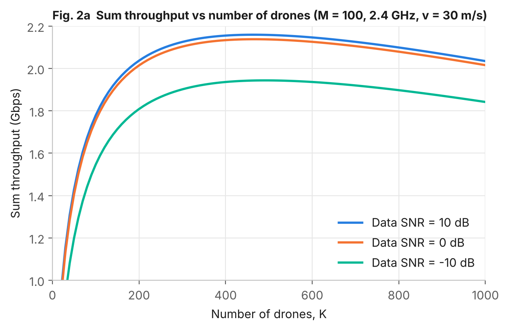
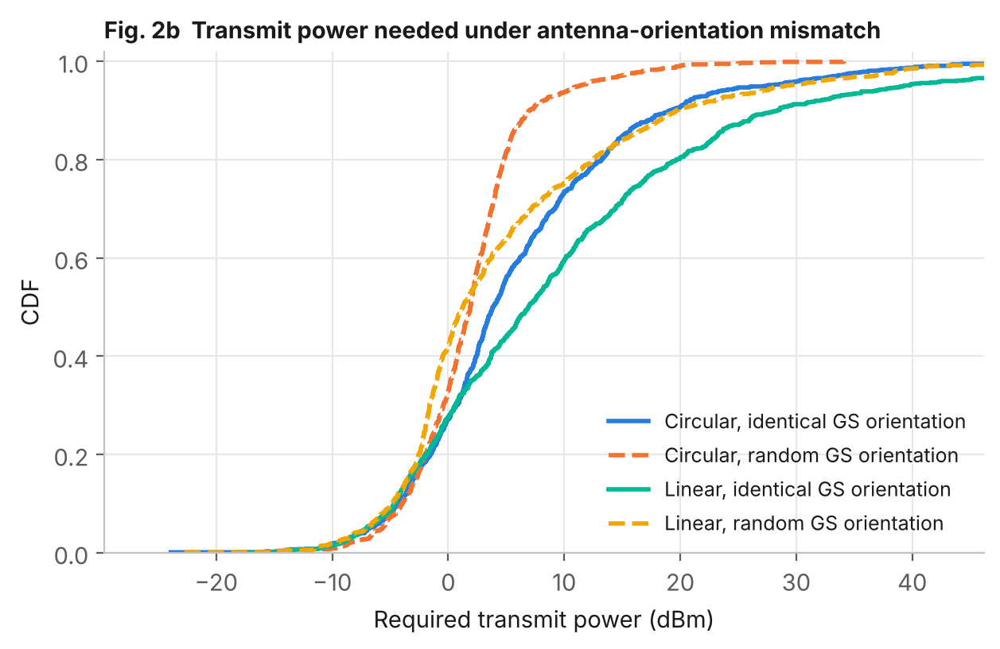
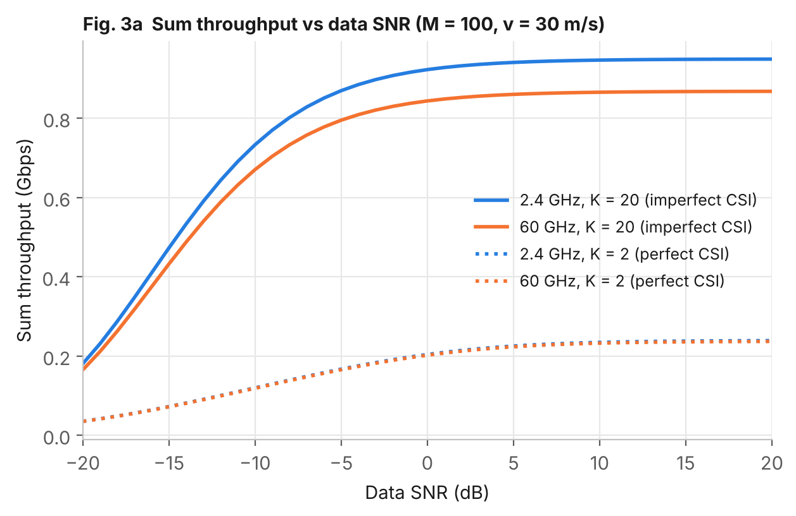
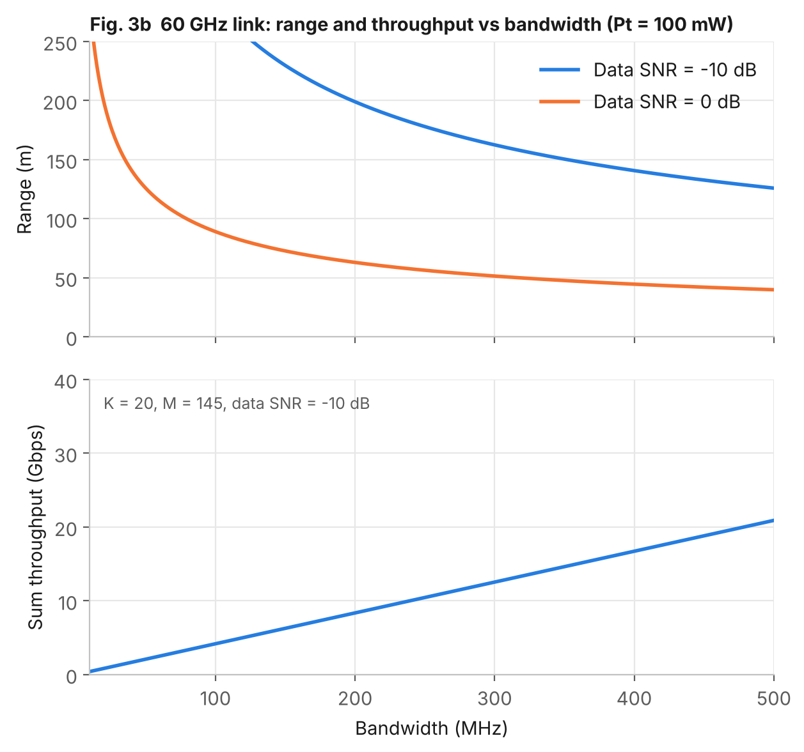
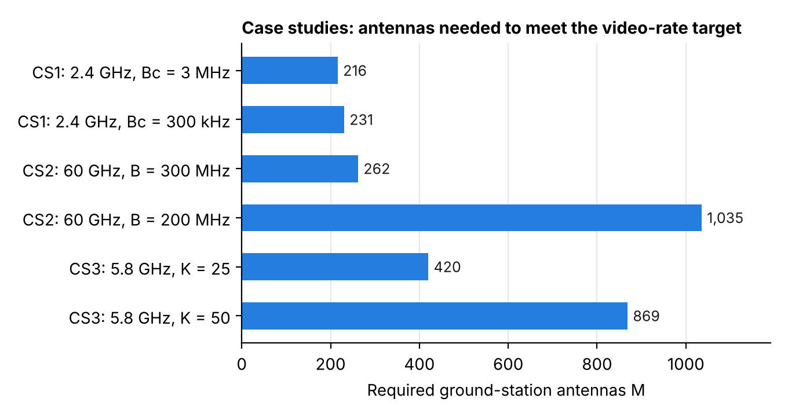

# Massive MIMO Drone Communications – Case Studies

Simulation code for the analysis of **massive-MIMO ground stations serving swarms of drones (UAVs)**:
sum-throughput scaling, the effect of carrier frequency and mobility, the range–bandwidth trade-off,
antenna-orientation / polarization mismatch, and three application case studies.

The original MATLAB code (`Magazine_Plots.m`, `polMismatch_Mag.m`, author: Prabhu Chandhar,
Chandhar Research Labs, Chennai, India) is kept unchanged. A Python port lives in [`python/`](python/)
and reproduces every figure and case-study number.

## Repository layout

```
├── Magazine_Plots.m          # original MATLAB: figures + case studies
├── polMismatch_Mag.m         # original MATLAB: polarization-mismatch Monte Carlo
├── python/
│   ├── mimo_drone.py         # closed-form model (throughput, range, required antennas)
│   ├── pol_mismatch.py       # vectorised port of polMismatch_Mag.m
│   ├── make_figures.py       # generates Figs. 2a, 2b, 3a, 3b
│   └── case_studies.py       # case studies 1–3 (table, CSV, bar chart)
├── figures/                  # generated PNGs
├── results/case_studies.csv  # generated case-study numbers
└── requirements.txt
```

## Quick start

```bash
pip install -r requirements.txt
cd python
python make_figures.py          # Figs. 2a, 2b, 3a, 3b  -> ../figures/
python case_studies.py          # case studies          -> ../results/, ../figures/
```

`make_figures.py` accepts `--drops N` (Monte-Carlo drops for Fig. 2b, default 1000) and `--seed S`.
The whole run takes a few seconds.

## System model

A ground station (GS) with **M** antennas serves **K** drones on the uplink. With pilot SNR
ρ<sub>p</sub>, data SNR ρ<sub>u</sub>, bandwidth B, coherence bandwidth B<sub>c</sub>,
carrier f<sub>c</sub> and drone speed v:

| Quantity | Expression |
|---|---|
| Coherence time | T<sub>c</sub> = c / (2 v f<sub>c</sub>) |
| Pilot/overhead efficiency | Λ = 0.9 − K / (B<sub>c</sub> T<sub>c</sub>) |
| Sum throughput | R = B · K · Λ · log<sub>2</sub>(1 + M ρ<sub>u</sub> / [ρ<sub>u</sub>(K−1) + 1 + (1+Kρ<sub>u</sub>)/(ρ<sub>u</sub>ρ<sub>p</sub>)]) |
| Free-space range | d = √P<sub>t</sub> · c / (4π f<sub>c</sub> √(N<sub>0</sub> B ρ<sub>u</sub>)) |
| Required antennas for per-drone rate r | M = [K − 1 + 1/ρ<sub>u</sub> + (1+Kρ<sub>u</sub>)/(ρ<sub>u</sub>²ρ<sub>p</sub>)] · (2<sup>r/(BΛ)</sup> − 1) |

N<sub>0</sub> = 2×10⁻²⁰ W/Hz throughout.

## Figures

### Fig. 2a – Sum throughput vs number of drones
M = 100, f<sub>c</sub> = 2.4 GHz, B = 20 MHz, B<sub>c</sub> = 3 MHz, v = 30 m/s, ρ<sub>p</sub> = 20 dB.



Throughput peaks around K ≈ 450–500 drones (~2.15 Gbps): beyond that, the pilot overhead K/(B<sub>c</sub>T<sub>c</sub>)
eats more than the extra multiplexing gain delivers. Raising data SNR from 0 to 10 dB gains very little;
the system is interference-limited.

### Fig. 2b – Transmit power under antenna-orientation / polarization mismatch
Monte-Carlo (1000 drops) with a 100-element half-wavelength GS array at 2.4 GHz, drones uniformly
placed within a 500 m sphere, half-wave-dipole patterns and random 3-D drone orientation. Plotted is
the CDF of the transmit power needed to reach 0 dB SNR, for circular vs linear polarization and identical
vs pseudo-randomly oriented GS elements.



Median required power (seed 1): circular/identical 3.9 dBm, circular/random 1.9 dBm,
linear/identical 6.9 dBm, linear/random 1.3 dBm. Randomly oriented GS elements cut the
heavy upper tail, because no drone orientation is simultaneously mismatched to every element.

### Fig. 3a – Sum throughput vs data SNR (2.4 GHz vs 60 GHz)
M = 100, v = 30 m/s. Solid: K = 20 with pilot-based (imperfect) CSI; dotted: K = 2 with perfect CSI.



At 60 GHz the coherence time is 25× shorter, so pilot overhead for K = 20 costs ~9 % throughput relative
to 2.4 GHz; for K = 2 the difference is negligible.

### Fig. 3b – Range and throughput vs bandwidth at 60 GHz
P<sub>t</sub> = 100 mW, K = 20, M = 145, v = 20 m/s. Shown as two panels sharing the bandwidth axis
(the MATLAB version uses `plotyy`).



Throughput grows linearly with bandwidth (~21 Gbps at 500 MHz), while range shrinks as 1/√B.

## Case studies

| Case | Scenario | f<sub>c</sub> | K | B | Per-drone rate | Sum rate | T<sub>c</sub> | Range | **Required M** |
|---|---|---|---|---|---|---|---|---|---|
| 1 | 4K@60 fps video, 200:1 compression, B<sub>c</sub> = 3 MHz | 2.4 GHz | 23 | 20 MHz | 60.4 Mbps | 1.39 Gbps | 3.13 ms | 15.7 km | **216** |
| 1 | same, B<sub>c</sub> = 300 kHz | 2.4 GHz | 23 | 20 MHz | 60.4 Mbps | 1.39 Gbps | 3.13 ms | 15.7 km | **231** |
| 2 | 16 × 4K@60 fps streams, 200:1 | 60 GHz | 20 | 300 MHz | 966 Mbps | 19.3 Gbps | 0.125 ms | 162 m | **262** |
| 2 | same, narrower band | 60 GHz | 20 | 200 MHz | 966 Mbps | 19.3 Gbps | 0.125 ms | 199 m | **1035** |
| 3 | uncompressed VGA@30 fps, 8 bpp | 5.8 GHz | 25 | 20 MHz | 73.7 Mbps | 1.84 Gbps | 0.86 ms | 2.06 km | **420** |
| 3 | same, double swarm | 5.8 GHz | 50 | 20 MHz | 73.7 Mbps | 3.69 Gbps | 0.86 ms | 2.06 km | **869** |

ρ<sub>u</sub> = 0 dB, ρ<sub>p</sub> = 20 dB. Case 1 and 2 use P<sub>t</sub> = 1 W; case 3 uses 100 mW.
Full numbers are in [`results/case_studies.csv`](results/case_studies.csv).



## Notes on the Python port

* The closed-form results (Figs. 2a, 3a, 3b and the case studies) are a direct transcription of
  `Magazine_Plots.m` and match it exactly.
* `pol_mismatch.py` vectorises the per-antenna loop of `polMismatch_Mag.m`. Two small changes:
  the required power is computed with each drop's own distance (the MATLAB code re-uses the last drop's
  distance for the whole vector), and drops closer than 20 m are discarded rather than stored as zeros.
  As in the original, the drone field is weighted by the GS element pattern (`E_UAV_R = E_UAV .* F_GS`).
* Fig. 3b's throughput axis is labelled Gbps (the computed quantity is R/10⁹); the MATLAB label says Mbps.
* Being Monte-Carlo, Fig. 2b changes slightly with `--seed`.
